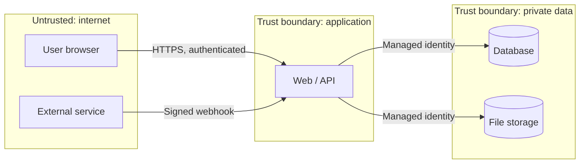

# Threat Model — <PROJECT_NAME>

| Item | Value |
|---|---|
| Owner | <SECURITY_OWNER> (security-reviewers) |
| Risk tier | <1 / 2 / 3 / 4> (Adactin AI Governance Framework) |
| Highest data class | <synthetic / internal / confidential / highly-confidential> |
| Last reviewed | <YYYY-MM-DD> by <NAME> |
| Method | STRIDE per component, plus AI build-time and run-time threats |

## When this file must be updated

Update it in the **same pull request** whenever a change:

- adds or changes authentication, sessions, roles or permissions;
- stores, exports or displays personal, financial or identity data;
- adds a file upload or download, an external integration, a webhook or an API;
- changes infrastructure, network exposure, CI/CD workflows or AI-assistant configuration;
- adds an AI/LLM feature, prompt or agent.

CI enforces this: the `Threat model updated for sensitive changes` check fails if
security-sensitive paths change without an update here, unless the author ticks
"Threat model: no update needed" in the pull request and explains why.

## 1. System overview

<One paragraph: what the system does, who uses it, where it runs.>

## 2. Assets and data classification

| Asset | Data class | Where stored | Who may access |
|---|---|---|---|
| <e.g. Candidate identity documents> | Highly confidential | <e.g. Blob storage> | <roles> |
| Secrets and keys | Highly confidential | Key Vault only | Workload identities |
| Source code and pipelines | Internal | GitHub | Teams via CODEOWNERS |

## 3. Actors and trust boundaries

| Actor | Trust level | Authenticated by |
|---|---|---|
| Staff user | Internal | <Entra ID SSO + MFA> |
| External user | Untrusted until verified | <method> |
| External service | Untrusted | <signature / mTLS> |
| CI/CD pipeline | Privileged workload | OIDC federation, no stored secrets |
| AI coding assistant | Untrusted actor with the developer's local rights | Developer identity; limited by `.claude/settings.json` |

## 4. Entry points

| Entry point | Exposed to | Auth required | Notes |
|---|---|---|---|
| <e.g. POST /api/uploads> | Internet | Yes | Size/type limits, malware scan |

## 5. Threat register (STRIDE)

Rating = Likelihood x Impact (H/M/L). Status: Open / Planned / Mitigated / Accepted.

| ID | Component | STRIDE | Threat | L | I | Rating | Mitigation | Status | Owner | Evidence |
|---|---|---|---|---|---|---|---|---|---|---|
| T01 | Auth | Spoofing | Stolen session or token used to impersonate a user | M | H | High | MFA, short-lived tokens, HttpOnly SameSite cookies | Planned | | |
| T02 | API | Tampering / EoP | User changes an ID to reach another person's record (broken access control) | H | H | Critical | Server-side, deny-by-default authorization on every request; negative tests | Planned | | |
| T03 | API | Repudiation | Sensitive action cannot be traced to a person | M | M | Medium | Append-only audit events with actor, time, action, target | Planned | | |
| T04 | Repo / logs | Info disclosure | Secrets or personal data committed or logged | M | H | High | gitleaks hook, push protection, log redaction | Mitigated (repo) | | |
| T05 | API | Denial of service | Unbounded uploads or requests exhaust resources | M | M | Medium | Size limits, rate limiting, timeouts | Planned | | |
| T06 | Admin | Elevation of privilege | Role administration abused to self-grant access | L | H | Medium | No self-grant, approval for privileged roles, audit | Planned | | |
| T07 | Supply chain | Tampering | Malicious, typosquatted or AI-hallucinated dependency | M | H | High | Dependency review, lockfile, human review of new packages | Mitigated (CI) | | |
| T08 | AI assistant | Tampering / Info disclosure | Coding agent runs destructive commands or reads secrets | M | H | High | Claude Code deny rules, no elevated sessions, PR-only changes | Mitigated (repo) | | |
| T09 | CI/CD | Tampering / EoP | Compromised action or workflow injection | L | H | Medium | SHA-pinned GitHub-only actions, read-only token, env-var inputs | Mitigated | | |
| T10 | AI feature | Tampering / Info disclosure | Prompt injection makes an AI feature leak data or take actions | <M> | <H> | | Treat model output as untrusted; least-privilege tools; human approval | n/a until AI feature | | |

## 6. AI-specific considerations

**Build time (AI-built code):** AI-generated code, specs and infrastructure are
reviewed as untrusted contributions; agents never hold production credentials;
facts stated by AI (versions, capabilities, legal claims) are verified.

**Run time (AI-enabled features), if any:** document model/provider, data sent to
it, retention terms, prompt-injection defences, output validation, human-in-the-loop
points and the kill switch.

## 7. Accepted risks

| ID | Risk | Reason accepted | Approved by | Expires |
|---|---|---|---|---|
| | | | | |

## 8. Review log

| Date | Change | Reviewer |
|---|---|---|
| <YYYY-MM-DD> | Initial threat model from template | |
